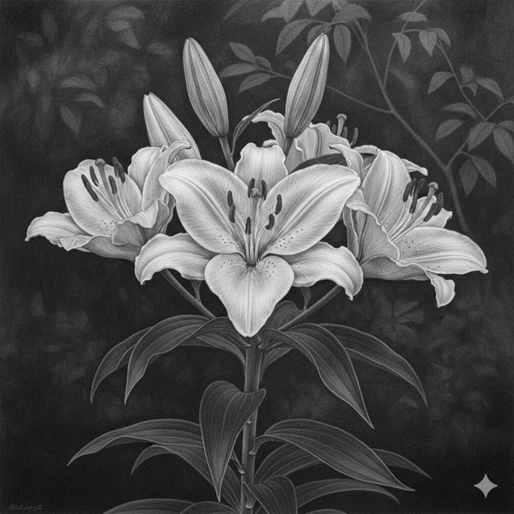

# The False Spring



```
My love, I know, I know,
That you know I love you,
For your words, voice, 
And the floral pattern in your palm
Make me know your love, 
	That you’re thinking of a coming Spring,
	A sudden rain,
	Our scrambling into a car,
	And that you know
	I long for the Spring as much
	When we will catch the last snowflake
	Dropping
	On the mud of Southern China,
Or perhaps, unfortunately woven
Into your cunning joke and my false dream.
```

