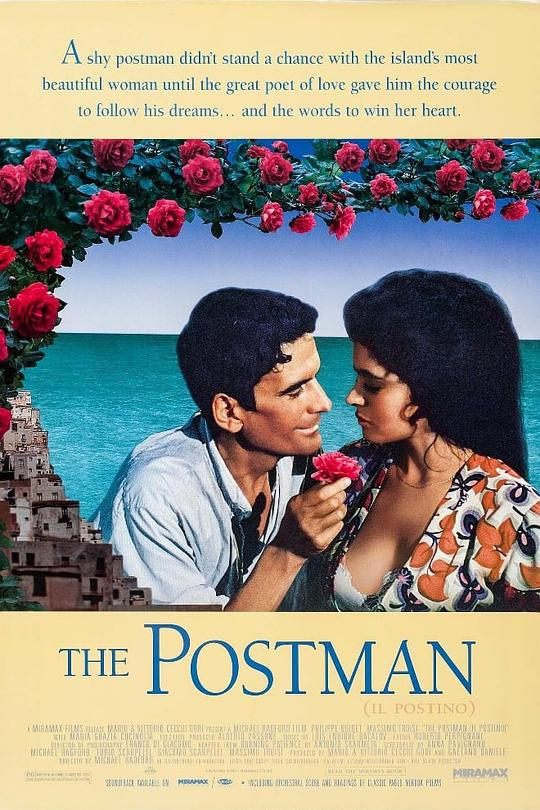

# 一切都从这里开始

两部电影，《邮差》和《马丁·伊顿》。没有想到这两部电影居然这么相像：首先这两部电影都是意大利人拍的。电影的主人公都是生活在社会底层的穷人，都是在穷人中混的比较差的穷人。出于一些意外，他们都从一些人身上接触到了文学和哲学，然后都着了迷似的沉浸在另一个世界，开始前所未有地深入思考自己的处境、社会的处境。最后，他们的结局也出奇地相似：他们生命的收尾不像我们大部分人一样，而是一个在集会中被刺杀，一个投海自杀；怎么说，他们似乎都有一点“英年早逝”或者是“不得善终”。

姑且认为他们的死亡都不是“善终”的吧，毕竟那些曾经鲜活、善良的生命的陨落永远都是让人扼腕和反思的悲剧。《邮差》中的马里奥在智利诗人聂鲁达的影响下投入到了共产主义运动，最后在一次共产主义集会中被杀死；马丁·伊顿成为了一个作家，当他越往社会的顶端走、越往深处思考，便越发现社会的无可救药，友情和爱情的最终逝去一点点侵蚀着他赖以生存的信念。直接向他们行凶的是糟糕的社会、丑恶的统治者。是可是如果这一切的一切没有开始呢？如果他们没有遇到最开始的意外呢？其实，“艺术是哲学的完成”，他们接触到诗歌、小说等艺术的时候，正是他们开始思考的时候，他们开始思考的时候，正是思考把他们的行为引向一处的时候。当他们碰到诗歌、小说等艺术时，他们的生命已经在某一页上提前画上了句号。古今中外，大抵如此；如果我们忽略一些因为具有悲剧性格成为了艺术家的人，因为爱上了艺术而缠上了导致悲剧的性格的，在历史上和文学史上可是大有人在。

这是必然的，因为他们所过的生活不再是经过前人反复试验的平凡生活，他们看到的也不再是无数人看到的简单图景。这其中的原因不太容易用一两句话说清楚。但是，清楚的是，如果马里奥没有开始思考或继续思考，他将过着平凡而不太富裕的小岛生活，或许还能娶到漂亮的妻子，不出意外能活到六七十岁；如果马丁伊顿没有开始思考，他将继续当一个四处旅行的水手，或者是随着爱人一起在社会顶层随波逐流过完富足的余生。至少，他们不会遭遇一场横祸。如果这一切都没有开始该多好，如果这两部电影没有开端该多好。当你把一个问题思考到深处，感到无法解决的矛盾、无法排解的绝望时，你感叹，“要是这一切没有开始该多好”。

但是，一个社会不能没有保罗高更的“开始”，不能没有海子的“开始”。我记得原来在贴吧上面看见一部电影的几帧画面，人物对白大致如下：“如果有人要先死，那一定是个诗人。”社会的进步往往要以一部分人的死亡作为开始或者助推，而一些先知先觉者往往不可避免地成为这些人。从这个角度来讲，他们也算是死得其所。

这样的“死得其所”有的时候还要等太久，或许是十年，或许是一个世纪。然而他们人生的意义不是自己看不见的历史书。苏格拉底的这一句话值得我们永远铭记在心：“不经过思考的人生是不值得过的。”思考有时给我们带来虚无和痛苦，可我们藉此拥抱了我们热爱的智慧，开始体会到了人生真正的滋味--人生这种东西，不思考的人是压根不会拥有的。你永远也不会忘记《邮差》中马里奥充满诗意的生活，诗歌给他带来了死亡，也给他带来了暗喻、诗意和理想。

思考--让我们从这里开始吧。
