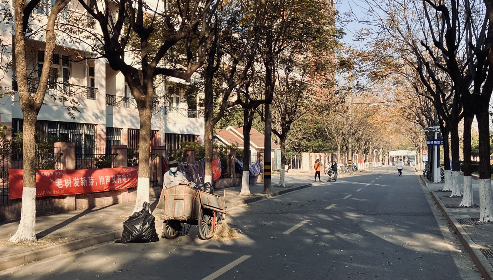
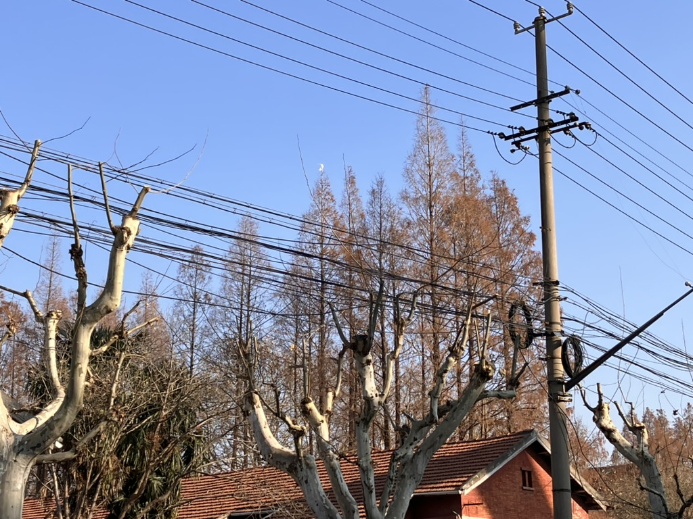

# 一毛钱一打的日记：一月

### 2023.1.2 一件事情干久了就会被异化
天太冷了，有的时候冷得都敲不起键盘。崩溃始于脸上一颗硕大无比的痘痘。仔细照镜子，小心翼翼地摸着自己的脸，就像一只没有必要讲卫生的猴子正在找身上的虱子。我不得不面对一个挺丑的自己，一个还是一个人的自己。突然感觉自己的生活真无趣。我甚至都不知道我的生活什么时候有过节日，有过盼头。2023？我居然还没有感觉他过来。人们友好地提醒了我，我竟也懒得想一下时间的流逝。

这真的就是一无所有了。

等哪天有时间了我再做一个回顾吧。虽然大部分时候这种回顾没有什么用。生活的目标和痛苦哪是一个晚上就能够想明白的。

---

非常羡慕那些每天都能够写博客的人。每天都意识到自己活着。意识到自己活着是一件要费功夫的事情，哪怕是在一天之中的最后一分钟幡然醒悟。我连这点力气都不肯使用。

---

今天整体可以，中午有一点颓。看个屁的手机。要是有室友在，你连B站都不会刷。还有，做题状态要慢慢进入。

### 2023.1.3  生存之道

真的感觉今天自己在“形式”上面尽力了。之所以没有认真完成计划、完成了的东西也没有做得那么出色，是因为总是抵挡不住疲惫。我发现了，搞学习这种东西，从高三到现在，我一天最多高效四个小时；其余的时间就开始摆了，要么是身处其中浑然不觉，要么是沉痛反思无限emo。

改变这种生活习惯（我又何尝不想自己是那种随开随用的机器呢？至少看上去像一点），我还没有找到办法。这个工作也许可以成为今后的一个重要任务。

最近的一个半成功经验：如果锚定一件事情，干的时候就要排除一切干扰源。一次只干好一件事。

### 2023.1.4 这就是生活
从生活区走到教室的路上，是我感受到生活的地方。

那种感受是这样来的：一月份下午的阳光与阴影照到了每一件事物上，于是他们都有了各自存在的理由。他们不再简单地出现我视野中的一角，而是有了来历，有了故事，有了使命。并不是说我看到了生活的“美”。“美”在我们惯常的视野中总是狭隘的，我们把“美”挂在嘴边的时候，往往是我们受够了丑的时候。现在我看到的应该是万物，没有美去筛选他们，只有这个时候他们才肯把自己藏得最深的东西展现出来。

这到底是怎样一种感受？感激？激动？还是愧疚？我不知道应该怎么描述，好像每一种强烈的情感出现在这里都不合适。我自然感谢下午的一束光，自然欣喜于自己漫步在街上，但是也愧疚，为什么一定要等着一束光的出现，为什么一定要走到街上才能够发现：原来这就是生活啊。

正像我也不知道如何通过文字来让观者，文字面前的你，如亲临现场一样，就像许多文学家、诗人做到的。我是应该找一台昂贵的相机来把他们定格下来吗？还是尝试着说出来落在挤在每一个角落里的枯叶、挂在树枝桠上随风飞舞的塑料布、或是扫着地的阿姨大叔们的样子？

还是别说了吧，免得，惊扰到生活。

### 2023.1.9 《银翼杀手2049观后感》以及一些废话

《银翼杀手2049》又是一部令人惊讶的杰作。《2049》和《2019》这两部杰作我都非常喜欢，都是那种看完之后想要倒回去看若干遍的作品。单说主题（一个作品有一个“主题”，在我看来是它有某一个方面的内容或者特质能够给你留下最深的印象）的设置，《2019》是关于恐惧与奇迹，《2049》关于回忆与自我，两部作品在这两个方面所作的探讨，可以说，是能够让观者感到焕然一新的。（至于一个作品的主题怎么界定，以及由此引申的这两个作品在叙述方面的特色，应该比较富有争议性，可以暂且不提）不能够忘记的是，《2049》是《2019》的续篇，两者共享一个叙事体系，在话题上也具有较高的延续性（《2049》对于《2019》的致敬本来就值得大夸特夸）。比如都讲了某一种具体的爱情，Deckard与Rachael的爱情，K与Joi的爱情，都无不是为让人无限叹息又能够掩卷沉思的罗曼故事。

“崔颢前头怕题诗”，但是《2049》绝对完美克服了许多“二次创作”的弊病，他是有自己的过人之处的。比如未来社会的构建，比如更加真实、精细、富有考量的摄影，比如K最后那个逼近诗意的结尾。

《2019》也有其不可超越处。他第一次在银幕上面向世人展现赛博朋克的社会，便已经把这个社会最本质的东西都讲了出来。可能有这样其中一个原因：作为古早科幻电影，它的“科幻味”并不是那种带有商业宣传性质的科幻味，它仍然不可避免地带着一身过去现实主义电影的坦诚与丰富。在这个方面上，《2019》永远是不可超越的神作。

看完两部电影，我又开始感叹，什么时候在我们的土地上在我的身边甚至在我的手下，能够诞生这样的作品。这类作品的光彩，我敢断言，一定是不容时间质疑的。更多时候是想问一问“为什么”。但是一想想许多喜剧演员凑热闹拍出来的科幻电影的票房成绩，再对比对比银翼杀手标志性的缓慢严肃的叙事，个中缘由也许非常清晰了。

哪天有时间希望自己能够再把这两部电影重新刷几遍。还想看纳博科夫的《微暗的火》。科幻可能已经成为我的type了。

---

《2049》中的miracle在精神实质上仍然是《2019》中的“things you people would never believe”,但是和《2019》中的“战舰起火，唐德赛门”相比，格局没有后者那么大。

我想，miracle作为wonder更加合适。这样更容易让人联想起“哲学始于惊奇”。

### 2023.1.16 野蛮依旧生长：初看《美国往事》

有的作品，真的只有那么长的篇幅才能够支撑得起它的骨架，因为读者必须要经过这么长的阅读时间才能够感受到作者想要表达的东西。《射雕英雄传》等一众武侠小说写了一章就可以不写了，但是《红楼梦》须得写满八十回；《卡拉马佐夫兄弟》惶惶两卷，但是“篇幅不大”，《尤利西斯》、《追忆似水年华》、《约翰·克里斯朵夫》又非得这么大的篇幅不可。
电影《美国往事》四个小时，对一部电影来说已是庞然大物，但是对于一个普鲁斯特式的、关于时间的电影来说，又刚刚好。这一部电影，总的来说，是“时间”与回忆的故事。“时间”不仅是物理意义上的时间，更是一切能够让事物面目全非的东西。时间最基本的性质就是无情，它像海浪一样冲刷一切，留下一片“丰饶之海”。《美国往事》整个四个小时就是在让读者感受这个东西，《红楼梦》也是这样。前者讲述一个文明和一群人的崛起，后者讲述一个文明和一群人的没落，但是他们带给我们的感受都是一致的：那就是“时间”的感受。

“延缘久未已，岁晚惜流光”。

往细里看，《美国往事》在具体题材上，和很多菲茨杰拉德（他正是那个拓荒时代的人）的作品，都是反映new money们在崛起的过程中，美国梦的破碎。其实，想开一点，New money登上历史舞台，是历史和物质发展的意旨，在这个过程中，“美国梦”并没有真正地破碎。名利、金钱、性，这些人类最野蛮的东西，在《美国往事》的刻画中，展现出了无比强大的、可以战胜一切文明、并形成一个新的文明的力量；任何守旧主义者，有的时候我们叫他们理想主义者，在这个过程中都会梦碎。野蛮的父辈繁衍了文质彬彬的子嗣，他们开始在肮脏的油井上构造别墅，在丑恶的交易后大开派对，在野蛮之上又构造一套虚弱无比的文明。

他们也开始奄奄一息。但是就像《欲望号街车》讲述的那样，总会有后人来掐死他们的脖子，这个过程永不停息。

文明不断死去，野蛮依旧生长。

### 2023.1.17
我好没本事。

### 2023.1.18
我好没本事

### 2023.1.19
我好没本事

### 2023.1.22
我好没本事

### 2023.1.27 我好没本事之五

好想念夏天。在夏天有电风扇，有一个穿着背心短裤的女孩陪着我一起喝冰啤酒。在夏天我可以每天洗澡，我的嗅觉会非常灵敏，闻到一切好闻的香味。晚上的城市显得格外地亲切，热风吹来你感觉你在拥抱整个城市的灯光，也格外动听，城市的声音如同潮水，城市的灯光如同渔灯。
太多故事都发生在夏天，太多梦想在夏天破碎，太多梦想在夏天升起，那真是一个理想的夏天，在我的未来中，在我的回忆里……让我亲身经历，我都愿意死在里面。

***

去年寒假是一段忙碌、焦虑、痛苦并存的日子。虽然过得不好，但是我自己很认可。去年的暑假、和今年的寒假确实完全不同的风味。我似乎觉得无所事事的生活很好过，至少让你自己觉得无所谓。这他妈是一种没有抵抗就放弃的日子，从任何角度来讲，我好像都没有活成自己想要的样子，甚至连内心最卑微的欲望都没有实现。我他妈不想这样活。

然而这样已经过去很久了。算一算，估计有个一百天了吧。

### 2023.1.28 单身狗的自白
今天某老板的情感史有一点震惊到我了。我以为爱情是一种伟大的契约，婚姻则是一种伟大而永恒的契约，从某个角度来说，它是人对无常与易逝的反抗。我原来很不理解所谓豪门对家族成员婚姻的异化，直到今天我才发现这样的事情就真真切切地发生在我的身边，是我身边一个真真切切的人。更让人难以接受的是，深陷在这种事情中的是一个巨大的社会群体，我身边最好的朋友可能也隶属其中。
对于他们来说，另一半是一个花一点点小钱就能够买断的工具。他们永远也不懂得另一个人身上独一无二的美、永远也不懂另一个人对于孤独和背叛的恐惧。

### 2023.1.29 流动的盛宴与倒霉的倒霉蛋
今天在小区门口的心宁书屋看到了《流动的盛宴》。我看了一点点。那真是一段贫穷而又丰富的岁月。我发现文学作品其实是在向人们传递不同的生活方式。《流动的盛宴》就是迷惘的那一代人生活的记录。海明威这个人虽然在某些方面富有争议性，但是他的真诚、坚强、自律在《流动的盛宴》中依然得到了很好的展示。这些都是我想要的。他的文学建树，也让人钦佩。
我并不关心这个世界怎样，我只想搞明白究竟如何生活其中。

***

我也算得上是一个老羽毛球了。在成为老羽毛球之前，我是一个老篮球。实话实说，我从运动中得到的乐趣真的少。竞争性运动一个很残酷的东西，只有打赢别人才能够享受乐趣。另一方面，运动这东西又很看天赋。这种天赋是一个很广的概念，一些后天难以改变的身体机能，和永不松懈的精神状态，再混合上争强好胜的大男子气概。与天赋丝毫不沾边的，真的只能说是倒霉蛋了。

运动这么久我的唯一收获就是：也许我就是这种倒霉蛋。

（遗憾的是，什么东西不要天赋呢？）

