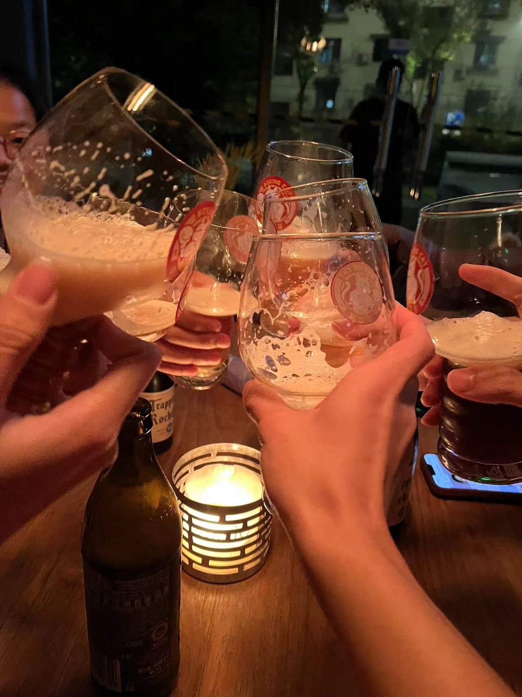

# 一毛钱一打的日记：十二月

### 2022.12.1 一场还没有投身的实践

文本的价值在于敞开，在于其模糊与多义。还可以更近一步，诗歌不仅仅是文本的，更是音乐的，图画的。这三种艺术形式都在不同的维度模糊与多义，都在不同的层面上接近诗歌。窃以为魏尔伦、马拉美一众诗人对诗歌音乐性的宗教式的崇拜表明了一个艺术创作的趋向：就是诗人们尝试拓展文本在其他维度的诗歌性。而其他艺术家们也总是寻求三者的打通。

### 2022.12.8 还不去搞学习

最近过得非常差劲。每天生活在焦虑之中。那些让我快乐的事情我也无福消受。感觉自己患上了病，却不知道病因在哪儿。

啊，要是我能够停下脚步感受这季节，这空气中冬季的香味，那路边上庄严洁白的梧桐，还有我身边想影帧一般闪过的人群，要是我能够感受、并且记录，让他们成为我真正享有的东西，这该多好啊！

我感觉我有精神上的洁癖。当然过早下定义还不恰当。现实就是，我迄今为止还没有发现比一个美丽的季节、一个动人的故事、一行让人稀里糊涂的诗更好的恋人。哪天就算我不诚实地成为了恋爱关系中的一环，我向往的也不过就是这些吧？我总怀疑，这种洁癖，不过是自卑的一种托辞。

昨天和沛峰聊了许久。人生不相见，动如参与商。虽然没有了物理意义上的分别，但是漂泊仍在继续。他似乎始终在我生命最初的那三年中生长着。而我却早已大变。他的一些话总是让我想到初中的时光：那个时候我们鲁莽，那个时候我们的生命干净得像一张白纸。

谢谢他。

### 2022.12.9 一个忙碌工作日的日常

明天就要考试了。感觉自己确实进步了许多，超然一点了，一些不必要的想法也都没有了。我的敏锐了应该要放到一些大苦难上面。

至于复习，一塌糊涂。我也没有什么办法，不过还是有一些可以反思的：1）时间安排。我发现别人的时间看上去总是比我的多。一方面要问心无愧，我自己能够投入的时间都投入了；另一方面要善于安排，比如今天晚上，一些计划之外的而且不紧急的活动千万不要心血来潮。2）善于复习。侯老师的《谈艺录》导读我虽然上的不认真，但是还算管窥了钱先生的治学方法。怎么着，天才他也善于做笔记、常常复习，用对待奢侈品的方式对待自己的知识。最近好多了，但是依然没有自主性。期末看吧！

至于明天考试的结果是什么，希望自己能够应对过去。真期待自己的反应呢。

### 2022.12.11

昨天晚上，合唱比赛结束之后，“十二卡座骑士”的八个人在大学路上的 _Bohemian Restaurant Bar_ 寻欢作乐。

今天是十二月十一号，酒馆里的人不少。酒馆排列在街边上，五光十色的人和酒杯陈列在酒馆里。

人需要别人。他们需要偷听别人的秘密，需要把自己认真经营的秘密泄露给别人，需要别人的祝福与告别。

玩了几圈，我有一点困乏了。我要么出神地盯着空空的酒杯，要么用手修旋转酒瓶，要么摊在座位上面，像一滩泥巴一样。今天为了演出穿了一身酒保一样的俏皮的衣服，还画了一脸妆。我们每天的生活都是如此。每天出门前我在棉袄底下打一个领结，给帽子底下的头发涂上发胶。我这是给谁看的呢？在座的各位有人要看吗？

酒杯一碰，结束了。生活还要继续。在这里毫不理智地昏睡一把，然后带着悔恨走出门。朋友们，要走了吗？我们虽然不熟，但是真的分别了吗？对啊，我的处境虽然没有改变，但是你们走之前让我意识到自己的处境，你们走之后它就被放大了。

我回到了寝室，总是不愿意睡。我之前幻想着一个浪漫的故事，现在只需要一个真心的慰藉了。但是，她曾经在酒杯中盛满了红色的酒，饮尽之后，剩下的杯底成了我干涩的眼睛，她好像在我遇到的每一个笑靥里停留过，只是，我现在还不知道她是谁。

我想回家。我不想回家。对一个男孩来说太老，对于一个男人来说太小。我不知道今后的路怎么走。

___

今天早上起来还是有一点低沉。不把悲伤形诸文字似乎又一点不甘心似的。但是人在犯晕的时候是写不出东西来的。创作和思考，本来就是积极人生的礼物。

无聊，看了一上午海明威的《太阳照常升起》。发掘他文字背后的美也需要硬汉的力气，但是我今天似乎不在这个状态。不过企鹅丛书开头的那句话我非常认同：

> 阅读经典也许可以被认为是对文化个性和多样性的最佳体验方式，此中的乐趣莫过于感受想象和思维的异质性，也即穿越时空阅尽人世的欣悦。

在殊途上领略不同的美景，在同归中找到最后的家园。当然后者往往是一个美好的幻想。

我倒是想起了海明威的《伊甸园》，我在高中的第一个学期有幸读过。一个行将就木的人，给我展现出多么宽广的未来日子啊。
