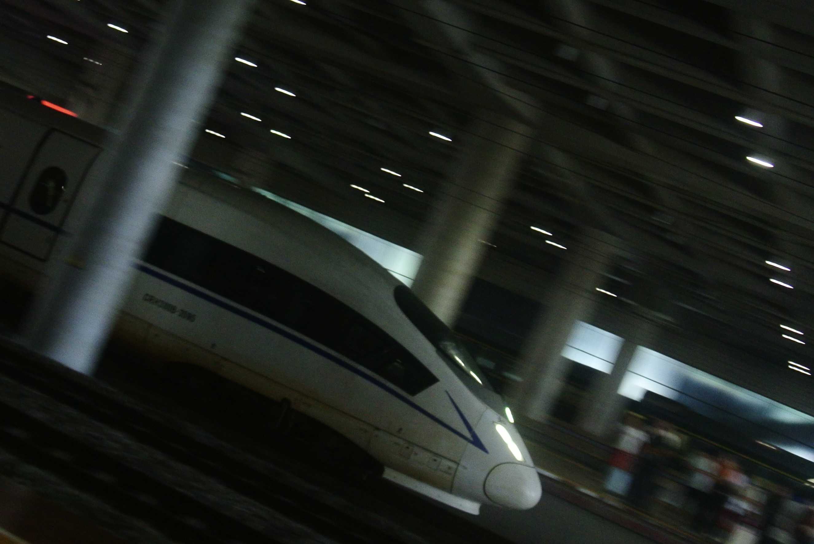
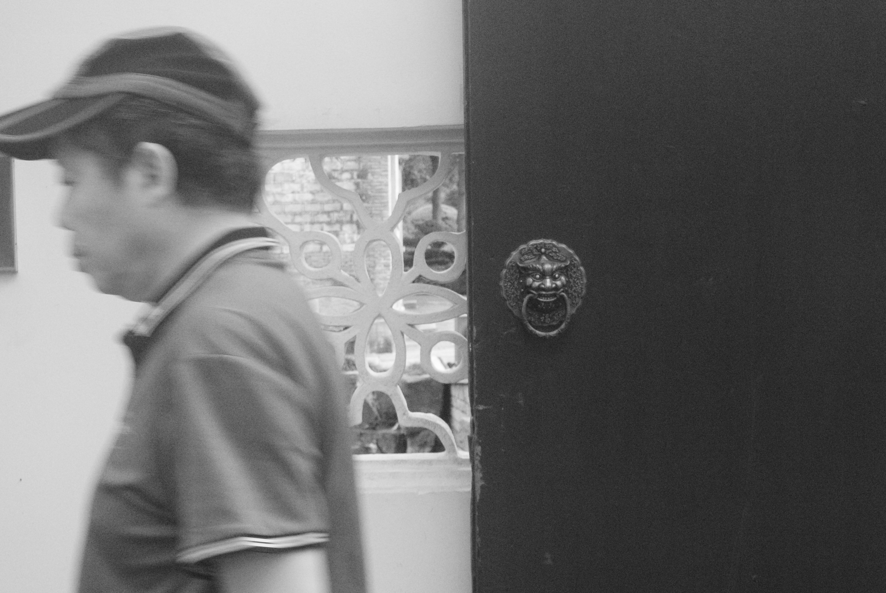
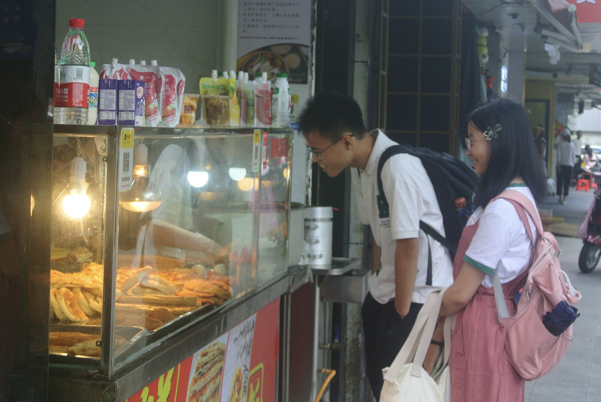
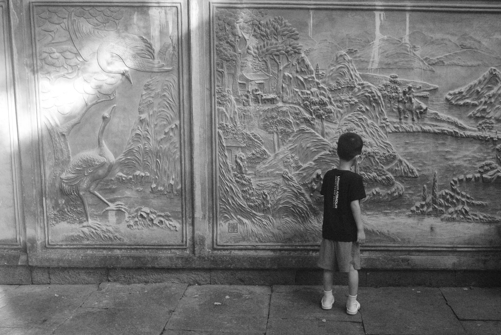
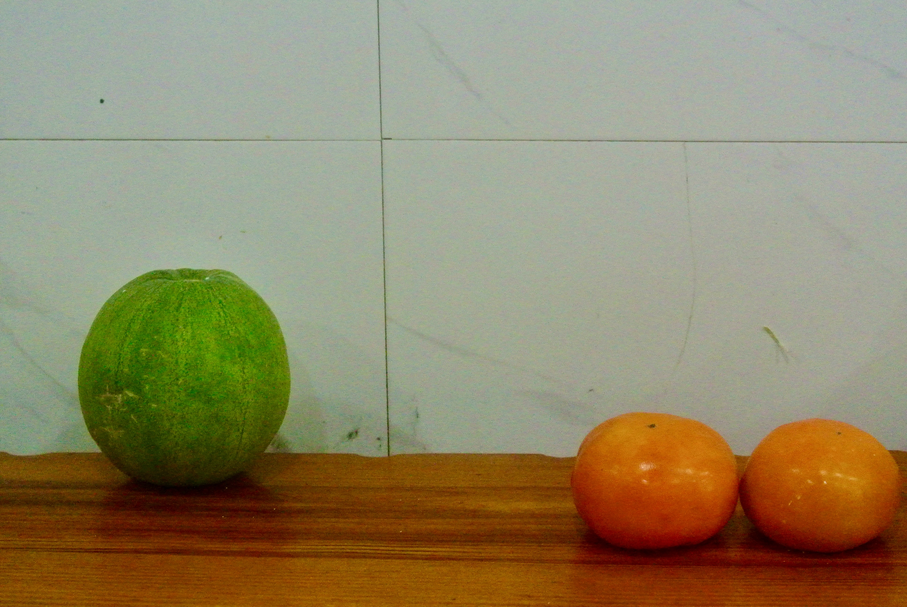
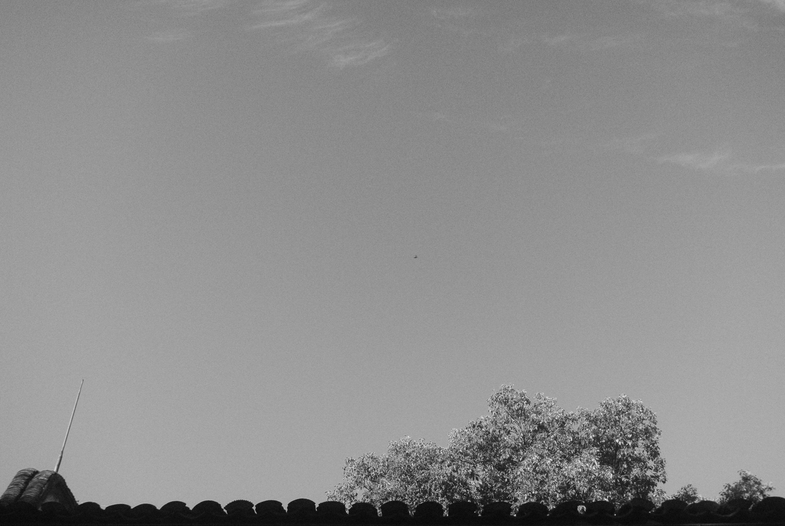
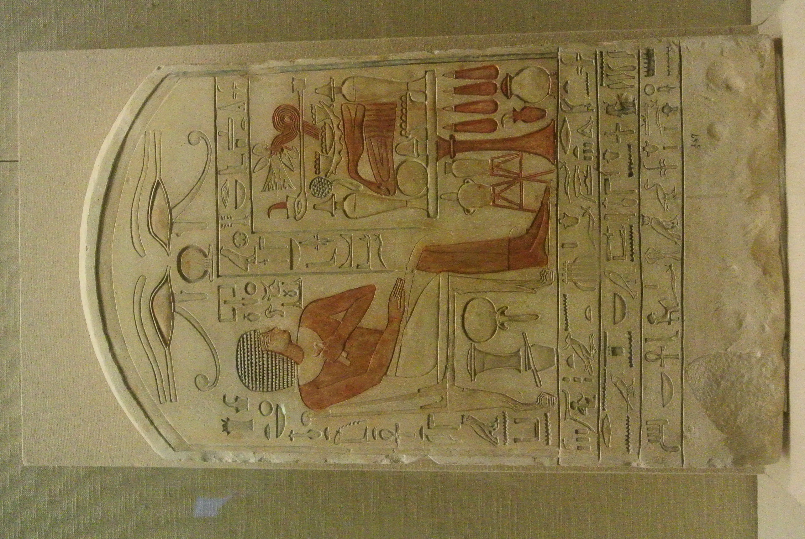
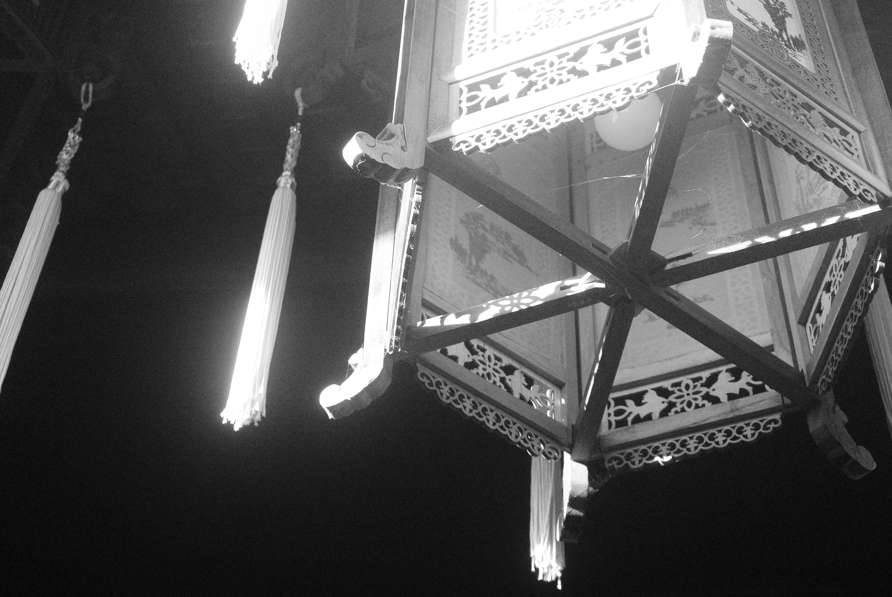
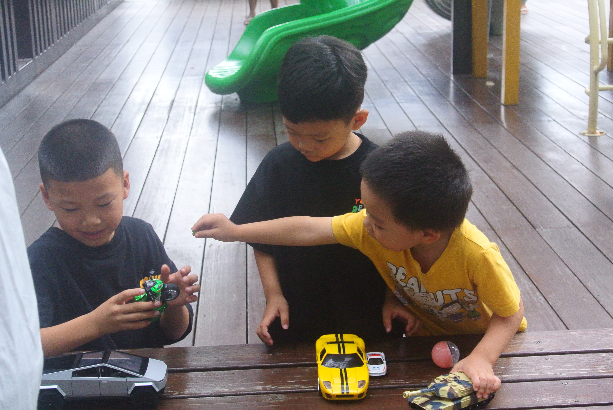

# 不要钱的相册：宁波之旅

书藏古今，港通天下。

我早就不知道自己想要什么了，我也一直不知道，无论是六年前、三年前，还是现在。今天从宁波回上海的路上，我也在想这个问题——可是是我自己想要坐在于江南平原的夜中呼啸而过的高铁上的么？想这个问题，真的是我想要的么？

火车到站，人海淹没了上海虹桥。上海是很多人这趟旅行的终点站，也是很多人一生的终点站。可是当他们离开站台，站在一望无际的现代的城市里，走到任何一个路口——

我曾经以为我告别了许多，于是可以重新开始，我跑到这样一个路口，却依旧茫然、脆弱、疲惫。当我跌倒在地上睡着，我周围的人还在不停地周流走动。
