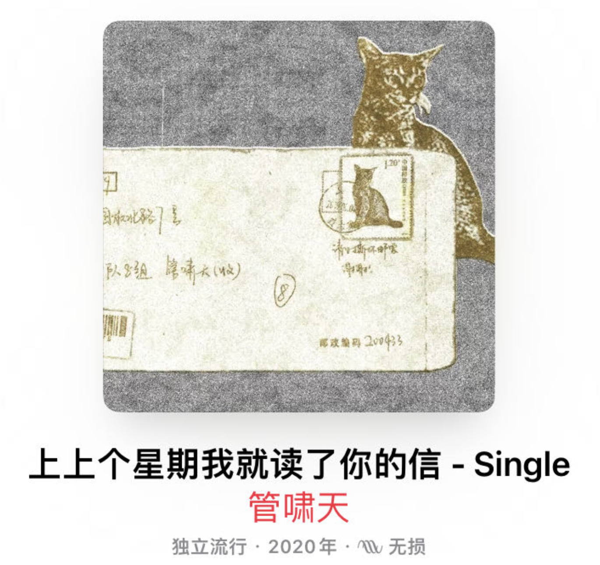

## 最近的诗

我珍惜并享受每一次写诗的机会。

### 和赵子佳在酒吧吃汉堡 2023.5.15 12:35
屋顶变湿了 就把灯光落在我的脸上
时光在我的眼前流逝 他们也是
如果我的生活也过得那么幸福
我不会拍一部永远拍不完的电影
在这里枯坐 然后等着一片云的降临

等待着它用夏意
滋润我的胸膛

### 暮春雨霁寻国权路七号 2023.5.3

为了一张专辑上面的地址
我来到这里
它是一个歌手的家
也是一个从未存在的门牌

雨声早就压在车轮底下
白雾被收回了下水道
天空刚亮 就埋下了头
灯光让小店昏暗，风扇让夏天沉闷

我坐下来 点餐 吃饭 顺便付错一次款
蓝包臀裙的老板娘和男人谈论着
买卖 女人 上海和另一个地方的天气
也许是福建吧 老板娘说福建的天气更加地阴沉

一个姑娘进来
我以为她会手里拿着矿泉水瓶，声音温柔
她却急切切地大声问着
厕所在哪里 

我的手机——我和另一个世界也许唯一的桥
也在饭桌上喧闹
喧闹声再次把我抛在异国他乡
切断了我和故乡唯一的讯息

地铁站 冒着冷气 是这条街唯一的冰汽水
也是我高中的一间小寝室
原来这将是我在上海的第一个夏天
你想多了 顶多是你人生的第十九个

到了一个地方
月色就变得荒凉
从什么时候开始
我就用不上月亮

总是在河东怀念着河西
在江南思念着江北
这里永远也不会属于我
每一年 我都去寻找一个国权路七号

###  苏湖载酒 2023.4.9

昨天我们喝超市的酒
今天我游苏湖的春
我想把一路的江南塞进一纸的胶卷

花香不飘 画堂就不亮
今天不过这座小桥
春闱不揭
丝弦不响

我想把沉默的江南塞进喧嚣的胶卷
然而她不会看多我一眼
历史也不会看多我们一眼
