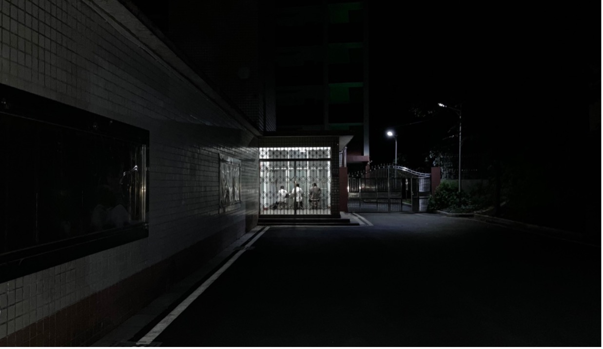
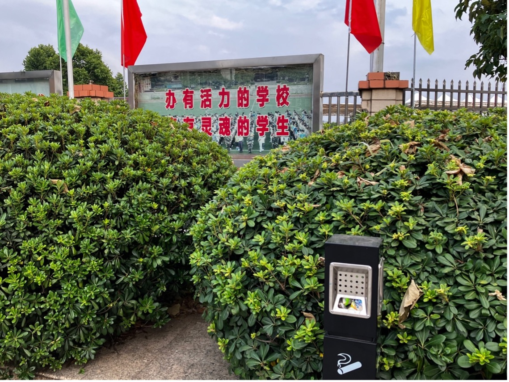
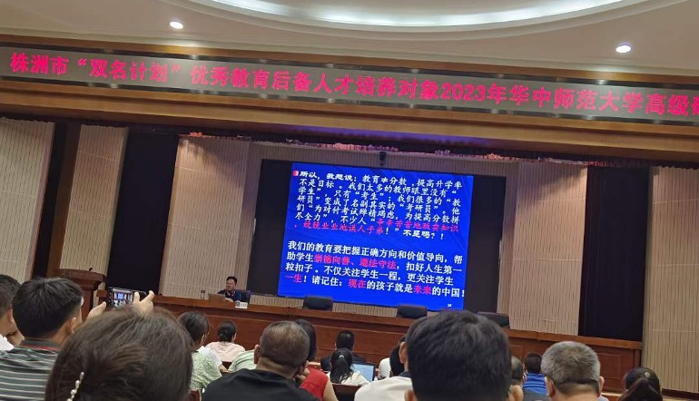
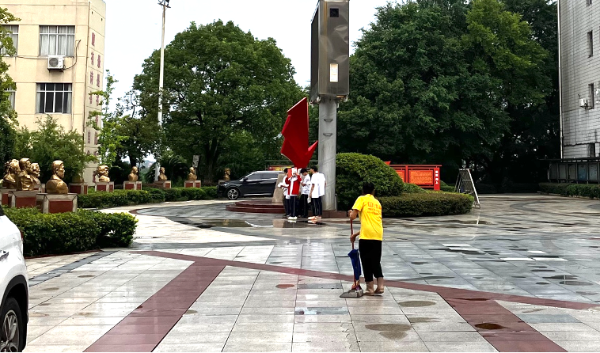
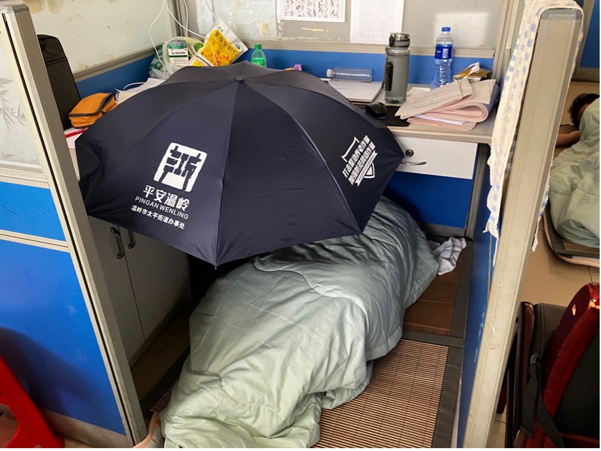

# 漫议县中教育｜教育的目的是人

## 一 导言

为什么我们依然孜孜不倦地谈论着县中教育？

是因为“县中”就是我们过去的一部分吗？是因为我们过去和现在的经历让我们对“县中教育”感同身受吗？还是它是一个不仅关系到我们自己、还关系到无数人的问题？

暑假，我跟着支教队来到C县一中进行了十天的支教。在这所C县最好的高中、湖南省示范性普通高等中学里，我们一起亲身经历了县中孩子的快乐和困苦，一起经历了他们的学习和日常。我常用“魔幻现实主义”来概括自己在C县一中的所见。可是，我的经历永远旁观，永远不如他们的经历那么完整、那么刻骨铭心。C县一中的一切，都需要孩子们自己去经历甚至承受。

这不是一份调研报告，而是一名任期十天的业余语文老师的日记。我希望它不是对系统性沉疴的指摘，而是与基层教育者和管理者的真诚交流。县中的问题是一个系统性问题的一部分，再有情怀的教育者也会感动无力，过多的要求可能都是苛求。但是我依然坚信，有的问题不应该让孩子承担——教育者本可以做得更好，学校本可以做得更好，县中教育本可以办得更好。

更何况，教育工作者永远是直接面对孩子们的那群人，一个人的改变带来的可能是一百个人一生的改变。

教育之神圣在于，它是一个有关于人的事业。 

## 二 被压缩的双语

我们支教团队语文备课组为这十天的教学安排了七个课时，涉及作文、语言文字运用、文言文和文学类文本，在保证教授内容具有体系性的基础上，我们尽量做到每个班都有自己合适的教学安排，也努力保证每个内容能由技术传授上升到素养熏陶，实现“道”与“术”的融合。

在教学的过程中，我也渐渐发现了孩子们的一些问题。一是阅读习惯、阅读能力和阅读积累不行。在教他们审读作文材料还有面批试卷的过程中，我发现大部分人都没有圈点勾画的习惯；有一次作业我下发了一篇小说，作业是给文本做旁批，许多人不知道什么是批注。对于大部分孩子来说，阅读习惯不行，提要钩玄、触类旁通的阅读能力更无从形成。中等水平及以下的学生，一套语文试卷做下来，有时根本不知道论述类文本和文学类文本在讲什么；一朝看不懂，终生看不懂。

可是为什么阅读习惯和阅读能力不行？因为阅读积累不够。老师能教会的阅读习惯和能力往往有限，更何况许多老师不教。我从许多学生那里得知，学校不允许他们看书。这种不允许不是我们想象的那种“不允许”——一是全面禁止，就连《红楼梦》这种课标要求且一度上过高考题的书都不准看；二是全时段禁止，孩子们没有属于自己的阅读课，就连晚上归寝之后看书也会被没收。而在这所学校里，大部分孩子都选择住宿。于是，大部分孩子没有了属于自己的夜晚。

阅读是双语教学中最奇怪也最富有魅力的部分。奇怪的地方在于，它很少被直接考察，以至于很多双语老师都有一种“读不懂也能做题”的错误观念；有魅力的地方在于，实际上，读不懂根本就做不了新高考的题目，而一门语言的精深、它能给人带来的快乐与馈赠，是无法被压缩在一道题目里的。

二是表达能力不行。一方面是口头表达能力不行。语文课堂上，鲜有人主动举手发言，也很少有学生能流畅地表达自己的所想。一个“创新班”里唯一主动举手发言的是C县一中的辩论队队长。我看到一个老师给他们布置了课前演讲，可这个活动也仅仅是局限在她教的那个好班里。英语方面，很多孩子不会读单词，更不会音标。为什么不会音标？因为老师不教，不仅不教，许多老师自己也不会。我从支教队一名成员那里听到一个让人哭笑不得的故事：他教一个孩子读一个单词，这个孩子反而理直气壮地说他读错了，然后自信满满地把一个错误的读法“教”给他。一问才知道，长久以来，他自己的老师就是这样教他的。

英语成绩高的人有的时候口语不见得好，这给人造成一种口语不重要的假象，甚至给个别教育工作者在教学体系上轻视口语的底气。殊不知，一个语言的美的最直观表现形式，就是它的口语表达。就算是只关注考试，好的口语最能给语言学习者带来自信和正反馈，对于C县一中的孩子们来说，这恰恰是他们缺的。而且，读不准单词，听力怎么听得懂呢？

口头表达能力在某种程度上是与书面表达能力息息相关的，所谓“我手写我口”。孩子们的语文写作情况基本可以这样概括：差的班，不知道要写什么；好的班，看上去写了许多，但是一细看，满纸都是“吾辈青年”“立大志”“明大德”这类气贯长虹的表达，内里逻辑却说不清道不明，我跟学生说这叫“用语言的丰富掩盖思想的缺位”，给他们看了几个“优秀范例”后，他们自己都觉得好笑。写作能力，归根到底有两个方面，一个是感性上共情和怜悯，一个是理性上进行反思和建构；用些大词、好句，在其次。我深知日常的随笔写作对于写作能力培养的重要性，可是就我对我教的四个班的了解，老师们从来不布置这方面的任务。

## 三 被忽略的受教育者
这背后固然有很多原因，但是，双语教育工作者的缺位，我认为是一个重要的原因。有好几次，几个同学拿试卷来找我面批，一看卷面，他们几乎不曾对过答案，也没有老师讲评的痕迹。我问他们为什么不对答案：答曰，这是周考试卷，周考试卷老师是不讲的，只报个答案；而老师似乎还挺节约纸张，连答案也不发一份给他们。我感到震惊的，一则是高一升高二的学生语文就开始周考了，二则是老师居然还不讲。试问，这种考试除了浪费纸张还有什么效果？最后的效果是，考的题目学生大部分不会，不会之后还是不懂。

也许省下来的时间是用来赶进度的，但是我发现老师课本也不认真教。新教材里选了我最喜欢的诗人昌耀的诗，我就问孩子们《峨日朵雪峰之侧》写的怎么样，他们说老师没讲过。

如此，老师似乎每天都在赶教学进度，而且看上还挺成功，既把课本翻完了，安排了若干场考试，而且还可以提早多久进入一轮复习，可是在这个过程中，学生收获了什么呢？

从以下这个事例中大致可以一窥背后究竟。我的工位原来是一名英语老师的。我在工位上看见一张试卷，其中一篇阅读可以错一两道题，一开始以为是哪个学生的，后来一看名字，是这位老师的试卷。过了几天这位老师回来拿自己的东西，看见英语备课组的队员们在备课，就问他们一节课可以讲几篇阅读。一名队员说一篇，而且讲完还很勉强，因为学生根本就读不懂文章，有的人甚至连mountain都不认识。那位老师炫耀般地说，自己一节课可以讲四篇阅读。我们问学生读懂文章没有，她支支吾吾了半天，最后答复是，反正学生也看不懂。

她的话中似乎隐藏着这种逻辑：教不好，是因为学生不好。我曾经一度以为，决定一个学校整体学风和教育成果的，是生源。现在发现，这成了部分教育者偷懒的借口，老师教不好反而可能是原因。教育不是完成指标，“有教无类”应是基本的教育心态。况且，C县一中的孩子资质真的就那么差吗？学生资质到底有没有高低我们暂不讨论，但是就世俗意义上的所谓“资质”而言，C县一中有的孩子真的很有灵气，甚至令我自愧不如。语文课后，有学生和我谈她对马尔克斯的理解，有学生推荐我看以赛亚·柏林的书，有个不爱说话的学生给我写信，她在书信的自由表达中展现出的对外物洞察的深刻和语言表达的精准，令人惊讶。他们有兴趣，有能力，有的还有深厚的基础，谈什么“底子差”呢？

在许多的教育情境中，缺席的往往不是受教育者，而是教育者。可能有的教育工作者确实存在自身水平的局限性，不知道高考考什么，不知道双语是什么，不知道学生真正需要的是什么，那更有理由去应该自我完善、提高自身教学能力。而有的教育工作者有能力，但是迫于内卷”大环境的压力，不敢在双语教育上放开手脚，把双语压缩成进度的完成和大量的刷题背诵，不注重基本内容的细化，更不注重学科能力的提升、完整灵魂的养成。

许多人似乎有这样一种错误的意识：素质教育是好学校专属的，因为他们没有应试压力；“内卷化教育”是县中的，因为他们要在数十万人中间杀出一条血路。可是，有两个问题：第一问，“内卷化教育”真的就能够把双语应试教好吗？不能。双语是最特殊的科目，应试和素养之间的鸿沟不大，双语的教学只能是慢功夫，回归最基本的教材教学、阅读写作，浇多少水就开多少花。第二问，“内卷化教育”真的符合教育初衷吗？答案也是否定的。教育终究是面向人的教育，而不是面向教育指标的教育。只是匆匆完成了教育指标，甚至可能赶出了一个好成绩，这样的教育又能够在孩子身上留下什么美好的痕迹呢？经年之后，当步入社会之后，他们会记得多少高中学到的东西呢？

## 四 被压缩的人

当然，讨论双语问题的同时，始终不能忽略的是，始终有一种外界的力量在压缩着它。高中时，我的物理老师说，“和县中的学生相比，你们最大的竞争优势是双语，因为县中的孩子们都学数学物理去了。”

我在C县一中看到了鲜活的现实：有的语文老师鼓励孩子们看书，但是年级组长会把书没收掉；有的班级晚自习的时间被划分成了几堂理科考试，学生根本没有时间花在双语之上。

双语被数理化压缩，其实是一个普遍现象，不仅在C县一中——北大中文系教授漆永祥说他和浙江某中学校长聊天的故事，“我就跟校长聊天，我说语文这么重要，你们为什么不重视语文呢？他说漆老师，我们还真不重视。我说为什么？他说我给你算，孩子到了高三他数学有点弱，很密地复习了1年，涨5分一点问题都没有，但语文这孩子本来能考120，拼命学了一年还考了115，这是可能的。尤其作文，本来能考40，他拼命练才考了42分，甚至考了39分”。

这位校长似乎为压缩双语提供了有力的辩解——可问题是，教育的成果真的能用分数来衡量吗？他们教育的对象是孩子，还是分数？

教育工作者对待教育的态度往往能够投射在学校的日常管理上。

C县一中的许多日常管理都让人难以理解：你经常可以在路上看见披着湿头发往教室赶的女孩子，难以想象学校是怎么衡量钱、时间和学生的健康的；学校教导女孩子们不要打伞，也不能“打扮得太干净”，因为她们不是“温室里的花朵”，要把注意力放在学习上；学校抓迟到抓得很严格，就算迟到了一分钟，也要拿着书站在教学楼外面，而湘东南的夏天，常常是艳阳高照、酷暑难当……

学校的日常管理目的，无外维持纪律，督学促学。C县一中设立这些管理措施的初心可以理解，其中也许还有几分强行赋予学生特殊的使命感的意味。可是，这些到底在什么层面上上能够促进学习和健康成长呢？或许，孩子们学习的兴趣、学习的精力，甚至生活的尊严，反而会在这个过程中被消耗殆尽。一场教育下来，被忽略的原来是他们。

这些管理措施，对于校园管理者而言也许只是一两个固执的观念、微小的细节，可对于孩子们而言，却一点点构成了他们日复一日的困惑、挫败和煎熬。

有时侯我无不沮丧地想，如果教育只会给孩子带来痛苦的话，我们真的能心安理得地声称这是为了他好、为了家庭、为了社会吗？一两年的热血和伤痛过后，他们被挤压得还剩些什么呢？

临行前的那次集会，二八班的一个学生坐在我旁边，他突然结结巴巴地问了我一个问题，“老师，人经历这么多痛苦，究竟是为了什么？”这个问题让我不知所措。我不知道是什么驱使他突然问出这个问题，我也不知道他遭遇了什么。

而且，对于这个问题，我到现在也没有答案。谁不是这样过来的呢，谁不要这样继续走下去呢？

## 五 C县一中的孩子们

在C县的那几天，我基本过着晚上两三点睡、早上六七点起的生活，每天最享受的是能够在中午裹着放在办公室的被子补上一觉。从C县回到长沙的那天晚上，我竟然一觉睡到了下午一点，一气呵成，酣畅淋漓。我这才发现在C县的那段日子真的挺难熬的，单论训练强度远胜军训，尤其是当自己的工作不被校方、个别老师还有不认真听课的一些家伙尊重的时候。

我高中的许多美好的回忆都是具体的人给的；现在想，我那段时间起床的动力恐怕也是具体的人给的。 因为我知道，上到真正动情的地方，孩子们会不禁发出“啊”“卧槽”之类的赞叹声；因为我知道，上完一节用心准备的课后，他们会不约而同向你报以掌声；因为我也许预感到孩子们真的把我们这群人看得很重要——最后的分别充满了停顿和艰难，虽然我从来不会为必然到来的分别感到不舍。我还记得课快要上完的那天，办公室里挤满了来找老师合照的学生，许多人的桌子上摆满了鲜花和学生给老师们准备的各种“小心思”，破防姐在那里替我们支教团的所有人流泪。喧嚣之中，二九班一名平时与我交流不多的男生跑到我面前，突然给我深深鞠了几躬，然后跟我说，“老师，真的很谢谢你们能来”，他小身板微微颤抖，眨着眼睛望了我几眼，就离开了办公室。

后来有不少学生给我们留了信，里面有一句是这样说的，“看见你在台上闪闪发光的样子，我突然就想起了我刚入高中时的一个目标，很简单——离开这儿。”。

我从来不会为必然到来的分别感到不舍，只会感到难受。

可能学语文的人最常有也最怕的事就是辞不达意，但是这一天，这些学生比我做得出色多了，反倒是我，一名不太出色的实习语文老师，站在那儿辞不达意。我不知道该对他们说些什么。

但是他们的心情我能够理解。我能够理解在需要时遇到一个“闪闪发光”的人的感受：他是给你带来关于远方和未来的讯息的使者，他能为你订好一张飞往北方的机票，告诉你将来某个夏天有多美好，然后支撑着你度过一两个难熬的年头。我不也曾是这样的孩子吗？我现在不也是这样的孩子吗？我不也像C县一中的孩子们一样，待在自己的“C县一中”里，有时无助地向外张望、有时甚至连头也不会抬吗？
 

我还记得那天晚上一个女生跑过来拿着便利贴对我说，“我本来不太喜欢夏天这个季节，但是你给了我一个喜欢夏天的理由。”我突然感到有一块铅块悬在我肚子里。女生急忙说老师你别哭。

——真对不住，既然辞难达意，就只好流几滴眼泪了。C县一中的孩子们啊，我们迟早能等来一个人改变夏天，又或者，能成为一个改变别人夏天的人。
