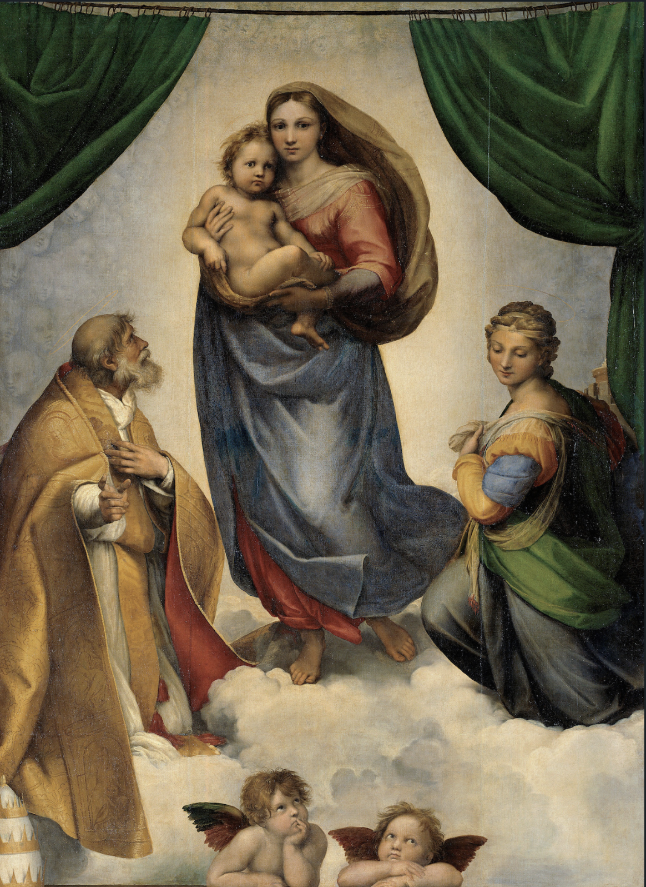

### 《西斯廷圣母》：我们的高尚，正望向我们自己

**一．**

在看傅雷先生的《世界美术名作二十讲》的时候，我早就对这幅画感触颇深；前天上赵老师的课，在更大的屏幕上面仰望拉斐尔的这幅画时，心中油然而生的崇敬与感动、温暖与悲伤，几乎让我热泪盈眶。以鄙之拙见妄评这幅杰作固然不当，而且已经可能是陈词滥调。但是我不得不说它。这是“艺术史上最动人的作品”[1]。我们可能可以找得到在形式和内容上比它伟大的作品，但是却很难找到一副比它更加动人的作品。每次观赏，都好像是一次人类精神的巡礼。

画面中，绿色的大幕徐徐拉开，在云彩之上，年轻的圣母怀抱幼儿耶稣，正要将耶稣送到人间（我们都知道，此去，耶稣将要承受人间的所有苦难）；画面左侧的老者，是圣西克斯图斯；画面的右侧娇媚温柔的女子是圣女巴尔勃，与老者共同将耶稣迎向人间；画面的底部则是两个可爱的小天使，那娇憨的样子好像正在苦苦思索此事情；大幕之后的背景则是这一个题材的常见元素，婴儿的图像。

画面整体是拉斐尔擅长的三角形构图，就像他之前几幅知名的圣母画，结构稳定，将我们的目光引向耶稣母女。

大幕的颜色是绿色，在色彩上面好像削减了画面沉重的气氛，同时也与圣女身上的颜色形成一种呼应，并不显得突兀。

我们赞叹于拉斐尔对多人物的安排，如同《牧我的群羊》、《捕鱼奇迹》等画一样，画中的人物安排具有一种“戏剧感”：耶稣母女此刻正平静而悲伤，目光望向画外；老者神态谦卑惶恐，与华贵衣着形成强烈对比，目光殷切地望向圣母；底部小天使好像在童真没有顾忌地四处地张望；圣芭芭拉姿势虔诚，目光低垂，好像是不忍直视母子分别，好像是深情地注视着两个小天使，也好像是低头望向人间。画面的元素相互联系，同时也也形成了具有张力的对比：老者之急切凸显圣母之平静，小天使之无知凸显母子之严肃，圣芭芭拉之慈祥和谐凸显圣母内心之沉重。于是我们将目光自然集中在画面中上部的圣母子。

在他们的身上我能够看到一种**人性与神性**的统一，既能够看到人类的普通，也能够看到人类的高尚。换言之，在他们的身上我们能够看到一个既熟悉但是又陌生的自己。

**二．**

画面之中，小耶稣并不像波提切利笔下的圣婴那么平静得有点老成，也不像是乔托笔下的那般简单地童稚；他是一种混合体。小耶稣的脸依旧是稚气未脱，那睁大的眼睛，乍一看上去像是展现出童稚第一次遇到世界苦难的那种惊讶，似乎还有一点点与母亲分别的忧郁；但是再仔细看一下那眼神，其中却闪着令人战栗的先知般的光芒，这忧郁是不是还饱含着对人类的深情？

不似许多画家笔下圣母的庄严、冷酷，也不似拉斐尔早年的圣母那般超凡脱俗（反倒是画面右下角的圣芭芭拉有一点像《园丁圣母》中的角色），**人性与神性**在她的身上交相辉映。她的背后是一层淡淡的光辉。头巾和衣着粗粝朴实，尽管是传统的红黄蓝配色，但是和其他许多“天上”的圣母比起来色彩却暗淡很多，好像笼罩着一种悲哀的深沉，与一个要与骨肉分别的母亲无异；但是，她的穿着却具有一种遒劲的力量感，只需要将她头巾、上衣和裙裾因风带起的褶皱与绿色的帷幕上的褶皱相对比你就会发现，这线条是多么的简洁有力，圣母走起来是多么的坚决。

看一看圣母的身姿，尽管她的双腿隐在长裙之下，但是看得出她大体是呈现S型站姿，重心落于一腿上，那优雅的体态好像就像是希腊题材的画里面走出来的一样；但是，她足尖点地，身体微微前倾，两腿靠近，似乎有一种将走未走将停未停之态，这一细节展现出来的交织着的爱的犹豫与责任的义无反顾令人动容。

再看一看圣母的手，右手抱住小耶稣将他紧紧依偎在自己身边，但左手好像又有着将小耶稣托付给人间的倾向。我们再看一看圣母的脸：鹅蛋形的脸庞，面容清秀俊俏，温润亲切，就如同一位漂亮的平凡年轻母亲。与小耶稣相比，她的脸上多了一种母性的宁静。但是她的眉宇间、眼神里、双唇上又隐藏着多少没有说出来的话语呢？那大大的眼睛中，流露出的是对分别时的悲戚与自失，还是对人类所受苦难的恻隐？紧抿的嘴唇还有宽广的额角上，到底是遏制住的悲伤苦涩，还是心系苍生的果决坦然？艺术语言本身具有丰富的多义性，都留待观者自己去解答，但是在这里，可以作兼有解。人性的不舍与痛苦，还有神性的奉献与悲悯，都自有一种照拂人心的光辉，在他们的身上矛盾着交织。

当然，看这幅画时，让我们感动的不止有圣母子身上人性神性交织在画布上的展现，还有**这种光辉对观者的投射**。我们感到的不仅仅是崇敬、悲伤，还有一种感动。与安格尔类似题材的圣母不一样的是，在这幅画中圣西克斯图斯手指指向画外，圣母子的目光也望向观者。他们正在向画布外面的我们走来。光辉好像就要从画面之外溢出，悲悯与抚慰好像就要降临。

这种投射更是一种身份意义上的投射。就像圣母背后那灿烂但又温柔不夸张的光芒一样，他们的形象如此高尚但是和我们又这么相似，他们虽站在云端但是和我们又如此近，我们好像看到了无数个历史的光辉页，好像看到了无数个真切而又高尚的人类形象……我们的目光渐渐回到我们自己身上……

**三**

赵琳老师的课叫《东西方美术巡礼》，一场跨越东西的巡礼何以成为可能？何以给我们感触？

钱锺书先生说，东海西海，心理倏同，南学北学，道数未裂。

东方西方，是人类艺术的双璧。水墨和油彩之下，是一样的心灵。

我们确实应该看到在画布上面，东方西方展现出来的观察方式、思维方式、世界观、宗教信仰，甚至给我们第一眼的艺术感受，是极不一样的。像陈丹青先承认“两组排列，其性质与脉迹颇难等同”，确实是一个非常真诚的态度。拿《西斯廷圣母》所隶属的宗教题材来说，他们的故事体系、价值观念、还有整体风格，均远异于中土的禅宗、佛学等。但是，当我们在莫高窟中瞻仰古老的佛本生故事画的时候，当我们览遍范宽马远秀丽山水的时候，当我们在细品李迪吴炳笔下的花鸟时，尽管进入方式迥异于西方，我们感受到的不都是一种自我的更新、对人类精神的叹服吗？就像《美的歷程》所说的，“心理结构创造艺术的永恒，永恒的艺术也创造、体现人类传流下来的社会性的共同心理结构。”

有人说，宗教本质上是人的自我神化。“神化”有一点言过其实。更恰当的是，不仅仅是宗教题材，任何好的作品都是一样，他们都在刻画人类自身，在**一种不失真实性但是又具有超越性的笔触中，让我们为自己做一个准确的定义。**

就像，西斯廷圣母背后的光芒是人类自身之光。我们的高尚正在望向我们自己；而我们，也要走近自己的高尚。
